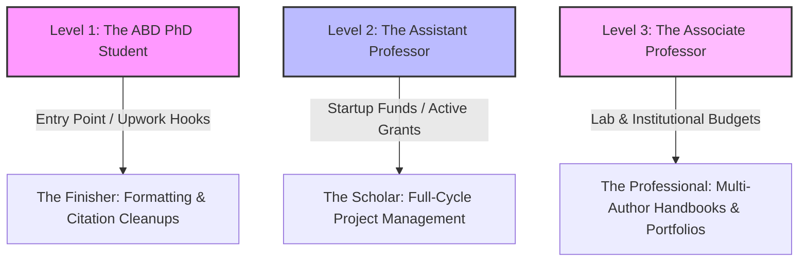
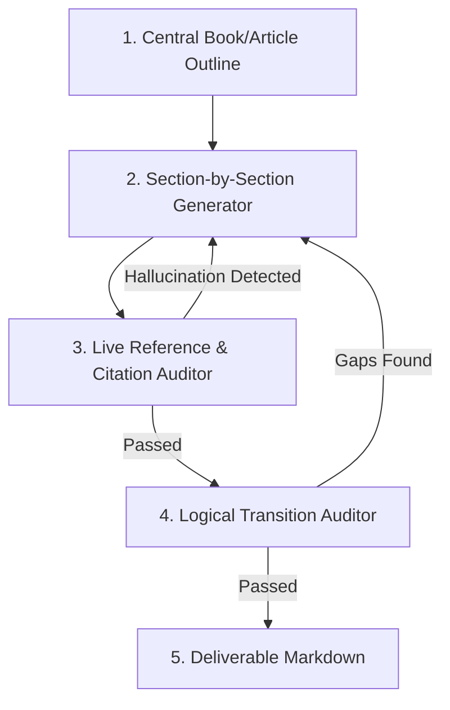

# 24: Agentic Workflow & Academic Lifecycle Methodology

This document bridges the strategic customer lifecycle with our future AI automation engine. It documents the **three customer levels**, Micah's professional expansion (including the **AP Research Reader** credential), and the multi-agent design pattern to replicate the user's manual "Deep Research" writing methodology when traffic scales.

---

## 📊 1. The Three-Tier Academic Customer Matrix

To scale the agency profitably, we must explicitly categorize our targets, their pain points, and their funding sources.



### Level 1: The PhD Student (ABD - All But Dissertation)
- **Mindset:** Stalled, isolated, struggling with contradictory committee feedback, trying to survive.
- **The Hurdle:** Needs structural proofreading, citation cleanup, and logic checking.
- **Pricing Service:** **The Finisher** ($0.04 - $0.06 / word). Paid out of pocket. 
- **Upwork Micro-Services:** Citation formatting, SPSS/R scripting, abstract styling.

### Level 2: The Assistant Professor (Micah's Profile - Tenure Track)
- **Mindset:** Racing against a 5-to-7 year tenure clock. Drowning in lectures and university service, but must publish peer-reviewed papers/books to keep their job.
- **The Hurdle:** High urgency, low time. Needs publication logistics handled so they can focus on high-impact research.
- **Pricing Service:** **The Scholar** (Milestone-based, $1,500 - $3,000/mo). Funded by university **Startup Packages** ($50k - $200k) or initial research grants.

### Level 3: The Associate / Full Professor (Lab & Project Directors)
- **Mindset:** Post-tenure, seeking promotion to Full Professor and institutional prestige. Often managing entire labs, multiple co-authors, and complex handbook projects.
- **The Hurdle:** Managing 20+ external contributors, maintaining multi-press simultaneous submissions, and keeping digital portfolios updated.
- **Pricing Service:** **The Professional** (Full Retainer, $5,000 - $15,000 flat project fee). Funded by major corporate or institutional grants.

---

## 🎓 2. The "AP Research Reader" Credential

Micah has recently served as an **AP Research Reader** (Advanced Placement Capstone Program by College Board). 
- **What this means:** He evaluates, scores, and audits high-stakes academic research manuscripts submitted by top-performing students globally, using strict, standardized rubrics.
- **How we leverage it:** This is a massive institutional authority signal. It proves to both PhD candidates and university departments that Micah is not just an editor, but a **certified evaluator of research design**. 
- **Website Placement:** Add this directly to the `/scholarcrafted/about` credentials list and homepage profile block:
  > *"AP Research Reader for the College Board, evaluating high-stakes academic research design."*

---

## 🤖 3. The Custom Multi-Agent "Section-by-Section" Writing Pipeline

The user currently executes a manual, high-utility writing methodology using the Gemini Web UI (Deep Research loops) to maintain deep research context, verify reference authenticity, and write logical, publication-grade chapters. When traffic scales, we will automate this using a **Multi-Agent Python/Pydantic AI worker** running alongside PocketBase.

### The Agentic Architecture



### 1. The Central Context Manager (The Author Agent)
- **Input:** The overarching manuscript topic, target publisher guidelines, methodology, and raw data files.
- **Role:** Maintains the "macro-level" outline and ensures each generated sub-section directly answers the overarching research questions.

### 2. The Section Generator Agent
- **Role:** Generates text section-by-section (e.g., Chapter 3: Data Analysis -> subsection 3.1.2). By working in isolated, small blocks, it maintains high focus and prevents context drift or general "hallucinated fluff."

### 3. The Live Reference & Citation Auditor (Pydantic Schema Validation)
- **Input:** Raw text outputted by the Generator + the project’s `.bib` file.
- **Verification Loop:** 
  1. Parses every in-text citation key (e.g., `[@smith2024]`).
  2. Query checks the key against the actual BibTeX database.
  3. Uses Pydantic schemas to validate that the reference is **real, on-topic, and contains complete metadata** (e.g. DOI, publisher, year).
  4. If a citation is hallucinated, it rejects the draft and tells the Generator: *"Reference not found in database. Re-write section using only active bib references."*

### 4. The Logical Transition Auditor (The Reader Agent)
- **Role:** Evaluates the transition between the completed section and the upcoming section. It ensures logical flow (e.g., avoiding sudden narrative breaks or contradictory arguments) and checks formatting compatibility with the target publisher's layout template.

### ⚙️ Why This Python Stack Wins (PydanticAI / FastAPI)
- **Constrained Output:** We pass Python type-hints and Pydantic models to Gemini/OpenAI, forcing the LLM to return exact JSON formats.
- **Graceful Retries:** If the AI fails validation, PydanticAI automatically loops the error back to the model with the exact validation trace, self-correcting before dumping files to PocketBase.
- **Go-Python Webhook Bridge:** PocketBase triggers this loop via a webhook to the Python container. Once completed, the Python container POSTs the finalized manuscript Markdown directly back to PocketBase.

---

## 📈 4. Client Acquisition & Psychological Selection Mapping

Here is the exact operational map of how a client navigates from initial acquisition channels to a specific service package based on their career stage and funding structures.

### Tier 1: The Finisher (Formatting & Compliance)
- **Acquisition Funnel:**
  ```
  Upwork Search / SEO Search ──> /audit Stepper ──> Flat-Rate Project Quote ──> The Finisher
  ```
- **The Psychological "Why":** **Friction Elimination & Deadline Panic.** The client has finished their draft but is terrified of immediate rejection due to style compliance or reference integrity. They need a fast, low-friction, guaranteed fix.
- **Funding Structure:** Out-of-pocket personal funds or small departmental stipends ($500 - $1,500).

### Tier 2: The Scholar (Methodology & Analytics)
- **Acquisition Funnel:**
  ```
  Direct Outbound (Email/LinkedIn) ──> "Startup Package" Pitch ──> Strategy Session ──> The Scholar Retainer
  ```
- **The Psychological "Why":** **Risk Mitigation & Tenure Protection.** The client needs peer-level verification of their research design before submitting it to a high-impact journal. If their statistical model fails peer review, they lose a year of their tenure clock.
- **Funding Structure:** **University Startup Packages** ($50k - $200k) or initial research grants. Zero out-of-pocket costs to the academic.

### Tier 3: The Professional (Full-Cycle Retainer)
- **Acquisition Funnel:**
  ```
  Micah's Magic Link / Institutional Outbound ──> Concierge Onboarding ──> Executive Proposal ──> Tier 3 Retainer
  ```
- **The Psychological "Why":** **Total Administrative Outsourcing.** The client is a Lab Director or Handbook Editor buried under co-author submissions, project deadlines, and publisher revision emails. They want to offload all operational logistics to a trusted faculty peer.
- **Funding Structure:** **Large Institutional Grants** ($100k - $500k+) or corporate research funding.

