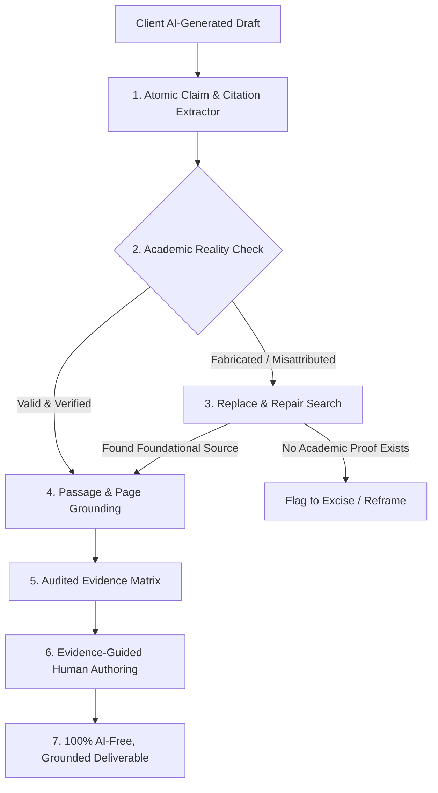
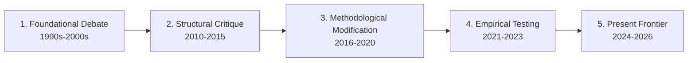
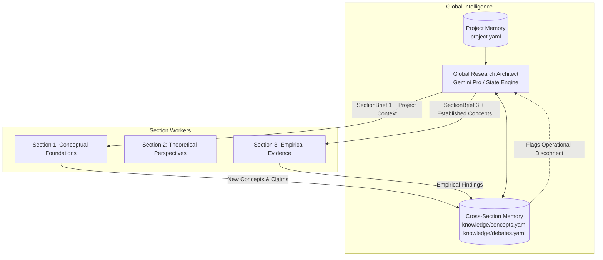

# 25: Scholarly Research Architecture & AI De-Fusing Methodology

## 1. Executive Summary & Purpose

This specification defines the dual-arm AI research, de-fusing, and verification system for **ScholarCrafted**. It bridges the gap between:
1. **Academic Integrity & Dignity**: Ensuring ScholarCrafted never operates as an unverified "AI ghostwriting mill."
2. **Client Reality (Arm A - The AI De-Fuser)**: Clients who bring panicked, hallucinated, or ungrounded AI drafts can have their work systematically audited, fact-checked, and reconstructed into authentic scholarship.
3. **Structured Research (Arm B - The Scholarly Co-Pilot)**: Enabling researchers to decompose large literature reviews into auditable, section-by-section evidence units with a 10-year intellectual genealogy.

---

## 2. Alignment & Evolution from Earlier Specifications

| Dimension | Older Architecture (`ai.md` / Doc 24) | New Evolution (Doc 25) |
| :--- | :--- | :--- |
| **Primary Scope** | Internal 1-pass text drafting pipeline. | **Dual-Arm**: Client AI De-Fusing (Arm A) + Section Research Co-Pilot (Arm B). |
| **Output Authoring** | Direct AI drafting of final manuscript prose. | **Evidence-Guided Human Authoring**: AI produces verified Evidence Maps; human writes final prose. |
| **Web Search Policy** | `google_search` tool strictly disabled (`tools=[{"type": "code_execution"}]`). | **Tiered Evidence Hierarchy**: Local Primary PDFs (Tier 1) > Academic Search (Tier 2) > Supplementary Web (Tier 3). |
| **Cross-Section Context** | None (sequential section-by-section with risk of tunnel vision). | **Global Research Architect** + 3-tier memory model solving Section 1 $\leftrightarrow$ Section 3 disconnect. |
| **Citation Handling** | Simple BibTeX key matching / Pydantic schema validation. | **Deep Passage-Grounding Matrix**: Claim $\leftrightarrow$ Exact Source Quote $\leftrightarrow$ Page $\leftrightarrow$ Context Evaluation. |
| **Interface** | PocketBase webhook $\to$ Python worker only. | **Dual Interface**: Standalone terminal CLI (`sc-cli` / `gai`) + PocketBase backend synchronization. |

---

## 3. The Three AI-Engagement Levels

To satisfy diverse institutional policies, university codes, and journal guidelines:

```
[Level 3: Zero-AI-Text]  ──> AI creates Evidence & Argument Maps only. 100% Human Prose.
[Level 2: Co-Pilot]      ──> AI maps debates, synthesis points, and structure. Human writes draft.
[Level 1: AI-Assisted]   ──> AI drafts section within deterministic contract; verified and edited by human.
```

1. **Level 3 (Human-Authored / Strict Zero-AI-Text Compliance)**:
   - For clients at universities or journals that strictly prohibit AI-generated prose.
   - The AI is **forbidden** from outputting narrative paragraphs.
   - The AI outputs *only* structured Evidence Matrices, Argument Maps, and Citation Verifications.
   - The human researcher/editor writes 100% of the narrative text from the verified evidence. Complete immunity to Turnitin / AI detection.

2. **Level 2 (Scholarly Research Co-Pilot)**:
   - For researchers with tight timelines who need intellectual clarity without relinquishing their voice.
   - AI outputs: Central research question $\to$ Source comparisons (Author A vs B) $\to$ Unresolved debates $\to$ Potential synthesis candidates.
   - The human writes the manuscript prose using this scaffold.

3. **Level 1 (Assisted Section Production)**:
   - Internal high-throughput drafting under strict deterministic section contracts (`section.yaml`).
   - Every generated sentence is linked to verified citations and reviewed by human editorial faculty.

---

## 4. Arm A: The Client AI "De-Fuser" Engine

When a client brings an AI-generated manuscript, treating it as final prose is fatal. The De-fuser treats the draft as a **Claim & Citation Hypothesis**.



### The 4-Step De-Fuser Protocol:
1. **Atomic Claim Extraction**: Parse the client's draft into discrete factual assertions $C_1, C_2, \dots, C_n$, identifying the attached citations.
2. **Academic Reality Check**: Query Crossref, Semantic Scholar, OpenAlex, or Google Scholar for each DOI/title:
   - *Valid*: Paper exists, authors match, topic aligns.
   - *Hallucinated Metadata*: Paper does not exist or author/title is fabricated.
   - *Misattributed*: Paper exists, but does not support the client's assertion.
3. **The "Replace & Repair" Search**:
   - If a citation is fabricated or misattributed, the engine searches the scholarly corpus for the *actual foundational literature* that establishes the claim.
   - If peer-reviewed evidence exists, the citation is replaced with the authentic primary source.
   - If no peer-reviewed support exists, the claim is flagged to be cut or reframed.
4. **Passage-Grounding & Audit Matrix**:
   - For every approved claim, extract the exact supporting quotation, section/page number, and evaluation status:
     - `SUPPORTED`: Direct evidence supports the claim.
     - `PARTIAL`: Supports with caveats or narrower scope.
     - `CONTRADICTS`: Primary source states the opposite.
     - `FABRICATED`: No literature found.
5. **Human Re-Authoring**:
   - The human editor/author crafts authentic prose from the cleaned Evidence Matrix, eliminating AI cadence, hallucinations, and generic fluff.

---

## 5. Arm B: Section-by-Section Research & 10-Year Intellectual Genealogy

Instead of searching only for recent papers (2023–2026), the engine traces the **intellectual trajectory** of the domain over the last 10+ years:



This prevents shallow summaries and gives the literature review the theoretical depth expected in doctoral dissertations and handbook chapters.

---

## 6. The 3-Tier Memory Architecture (Solving Section 1 $\leftrightarrow$ Section 3 Tunnel Vision)



### The Three Memory Layers:
1. **Tier 1: Project Memory (`project.yaml`)**:
   - Master thesis statement, core research questions, overall scope, deliverable blueprint (e.g. IMRaD, Monograph), citation style (APA 7th, Chicago, etc.).
   - Permanent and immutable across the project lifecycle.
2. **Tier 2: Section Memory (`sections/{id}/`)**:
   - Specific section contract (`section.yaml`), target word count, assigned local PDFs, extracted evidence matrix, and verified citation list.
   - Scoped strictly to the active worker.
3. **Tier 3: Cross-Section Memory (`knowledge/`)**:
   - `concepts.yaml`: Working definitions established in earlier sections (e.g. "Digital Inclusion" defined in Sec 1).
   - `debates.yaml`: Ongoing academic tensions and school-of-thought disagreements.
   - `contradictions.yaml`: Disconnects surfaced between sections (e.g. Section 3's empirical papers measuring digital inclusion purely as internet speed vs Section 1's multi-dimensional definition).
   - `cross_links.yaml`: Relationships and conceptual dependencies between sections.

---

## 7. Canonical File-Based State Structure

Every project adheres to this deterministic directory layout:

```text
my-dissertation-project/
├── project.yaml                 # Master thesis, methodology, citation style, blueprint
├── protocol/
│   ├── literature-review.yaml   # Search constraints, inclusion/exclusion rules
│   └── citation-policy.yaml     # Evidence hierarchy, verification thresholds
├── knowledge/
│   ├── concepts.yaml            # Project-wide concept definitions
│   ├── debates.yaml             # Core theoretical and empirical debates
│   ├── contradictions.yaml      # Cross-section disconnects flagged for review
│   └── cross-links.yaml         # Conceptual graph linking sections
├── sections/
│   ├── 01-conceptual-foundations/
│   │   ├── section.yaml         # Section contract & target word count
│   │   ├── evidence_matrix.yaml # Claims, sources, passages, and audit statuses
│   │   ├── argument_map.md      # Structured debate and synthesis notes
│   │   └── draft.md             # Level 1 draft or Level 2/3 human-authored text
│   ├── 02-theory/
│   └── 03-empirical-evidence/
└── sources/
    ├── primary_pdfs/            # Local primary uploaded papers (Tier 1)
    ├── discovered_papers/       # Discovered peer-reviewed literature (Tier 2)
    └── citation_index.bib       # Verified BibTeX database
```

---

## 8. CLI Interface Specification (`sc-cli` / `gai`)

The terminal CLI provides instant developer and editor access to every engine capability:

```bash
# General query without web or deep research
sc-cli ask "Explain the conceptual differences between Bourdieu and Putnam on social capital"

# Generate a structured research plan for a section
sc-cli plan --section 02 "Map theoretical perspectives on institutional trust"

# Execute deep research grounded in primary documents and verified web literature
sc-cli research --section 02 --docs ./sources/primary_pdfs/

# De-fuse and audit a client-provided AI draft
sc-cli defuse --input client_draft.docx --output ./sections/01/evidence_matrix.yaml

# Run the Citation Verification Engine against the evidence matrix
sc-cli verify --matrix ./sections/01/evidence_matrix.yaml

# Synchronize local state with PocketBase backend
sc-cli sync --project "DISSERTATION-2026-09"
```

---

## 9. Next Architectural Evolution: The Internal TipTap Workbench

For the complete frontend editorial workbench specification, including the **3-Column Split-Screen Canvas**, **TipTap Tracked Changes & Comments Extension Suite**, **Thesify-Class Diagnostic Modules**, and **Word Track Changes Export Pipeline**, see:

👉 **[26: Internal TipTap Editor & Multi-Agent Workbench Specification](./26_internal_tiptap_editor_and_agent_workbench.md)**

