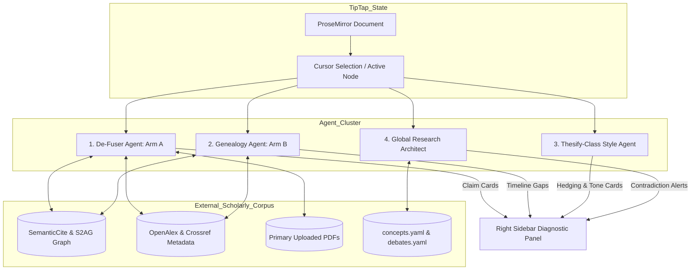

# 26: Internal TipTap Editor & Multi-Agent Workbench Specification

## 1. Executive Summary & Strategic Positioning

This specification defines the internal editorial workbench for **ScholarCrafted**, expanding upon **Doc 25 (Scholarly Research Architecture & AI De-Fusing Methodology)**.

### The Pure-SaaS Trap vs. ScholarCrafted Faculty-in-the-Loop
Consumer-facing AI academic tools (such as **Thesify**, **Jenni AI**, and **Paperpal**) sell directly to students as standalone subscriptions ($15–$30/mo). While effective at surface-level feedback, they suffer from three fatal structural limitations in high-stakes scholarship:

1. **Illusion of Verification**: They check whether citation formatting *looks* like APA 7 or IEEE; they cannot verify whether a cited empirical finding was hallucinated, misquoted, or disproven.
2. **Section Tunnel Vision**: They process text locally (paragraph-by-paragraph or page-by-page), failing to detect when Section 3 contradicts the theoretical definitions established in Chapter 1.
3. **Plagiarism & Detection Exposure**: By encouraging students to accept automated AI-generated prose insertions directly, they leave manuscripts vulnerable to institutional Turnitin/AI-flagging algorithms and committee rejection.

```
┌─────────────────────────────────────────────────────────────────────────────┐
│                       SCHOLARCRAFTED COMPETITIVE MOAT                       │
├─────────────────────────────────────────────────────────────────────────────┤
│ • We do NOT sell unguided SaaS to students.                                 │
│ • We operate this workbench INTERNALLY as our Faculty Command Center.       │
│ • Multi-agent diagnostics run in the background (Thesify-class speed).      │
│ • PhD Faculty review, ground, and polish the manuscript in TipTap.          │
│ • Client receives 100% human-verified prose delivered in Track Changes.     │
│ • Premium consulting economics: $1,500 – $6,000+ per engagement.            │
└─────────────────────────────────────────────────────────────────────────────┘
```

---

## 2. The 3-Column Split-Screen Workbench Layout

The editor is built as an internal Next.js application using **TipTap (ProseMirror)**, **Tailwind CSS**, **Mantine / Shadcn UI**, and **Zustand**.

```
┌────────────────────────┬────────────────────────────────────────────┬─────────────────────────────┐
│ 1. KNOWLEDGE & MEMORY  │           2. TIPTAP EDITOR                 │ 3. AGENT AUDIT & SIDEBAR    │
│    (Context Engine)    │        (Active Manuscript Node)            │    (Thesify-Class Audits)   │
├────────────────────────┼────────────────────────────────────────────┼─────────────────────────────┤
│ 📁 Project Memory      │ # Chapter 3: Theoretical Framework         │ 🔴 DE-FUSER AUDIT (Arm A)   │
│ ├─ project.yaml        │                                            │ Claim C14: [Unsupported]   │
│ ├─ Blueprint: Monograph│ Digital inclusion cannot be understood     │ "Studies show 84% jump..."  │
│ └─ Style: Chicago 17th │ purely as physical access to technology.   │ ⚠️ Citation hallucinated.   │
│                        │ Rather, as [Castells (2012)]<cite-flag>    │ 💡 Suggested Authentic:     │
│ 🧠 Cross-Section Memory│ argued, it represents a structural         │ → van Dijk (2005) p. 42     │
│ ├─ Concepts:           │ precondition for civic participation.      │ [Replace & Ground] [Dismiss]│
│ │  └─ "Digital Equity" │                                            │                             │
│ │     (Def. in Ch. 1)  │ However, empirical evaluations in urban    │ 🟡 INTELLECTUAL GENEALOGY   │
│ ├─ Active Debates:     │ districts show a marked divergence between │ Missing 10-Yr Transition:   │
│ │  └─ Access vs Agency │ access and actual agency...                │ Literature jumps 2004→2024. │
│ └─ Flagged Mismatches: │                                            │ Missing 2014-2018 critique  │
│    ⚠️ Sec 3 uses pure  │                                            │ (Hargittai, Selwyn).        │
│       bandwidth metric.│                                            │ [Explore 2016 Nodes]        │
│                        │                                            │                             │
│ 📑 Primary Sources     │                                            │ 🟢 STYLE & CADENCE (Thesify)│
│ ├─ castells_2012.pdf   │                                            │ Line 42: "Pivotal role"     │
│ └─ van_dijk_2005.pdf   │                                            │ → AI cadence detected.      │
│                        │                                            │ Suggest: "decisive factor"  │
└────────────────────────┴────────────────────────────────────────────┴─────────────────────────────┘
```

### Column Responsibilities:
1. **Column 1: Memory & Source Navigator (Left, 280px)**
   - Houses the 3-tier memory state from Doc 25 (`project.yaml`, `concepts.yaml`, `debates.yaml`, `contradictions.yaml`).
   - Displays loaded primary PDFs with passage-extraction status.
   - Allows switching between project chapters and sections with instant context swapping.

2. **Column 2: TipTap Manuscript Canvas (Center, Fluid)**
   - Distraction-free, typography-focused ProseMirror document canvas.
   - Renders custom node and mark extensions: `<claim-node>`, `<citation-flag>`, and `<cadence-warning>`.
   - Supports live Tracked Changes highlighting (insertions in green underline, deletions in strikethrough).

3. **Column 3: Multi-Agent Audit & Diagnostic Sidebar (Right, 380px)**
   - Displays real-time inspection cards synchronized with the editor cursor position.
   - Hosts the **De-Fuser Engine (Arm A)**, **Genealogy Inspector (Arm B)**, **Thesify-Class Style Metrics**, and **Global Architect Alerts**.

---

## 3. TipTap Extension Suite Architecture

To support doctoral-level editorial operations, the TipTap instance combines official Pro extensions with bespoke academic extensions:

```
┌─────────────────────────────────────────────────────────────────────────────┐
│                           TIPTAP EXTENSIONS MATRIX                          │
├─────────────────────────────────────────────────────────────────────────────┤
│ Core & Formatting    : StarterKit, Typography, Table, TableRow, TableHeader  │
│ Document Review      : TrackedChanges (@tiptap-pro), Comments, Compare      │
│ Agentic AI Engine    : Server AI Toolkit, aiTextPrompt, tiptapEditHooks     │
│ Academic Custom Nodes: ClaimNode, CitationFlag, CadenceWarningMark          │
└─────────────────────────────────────────────────────────────────────────────┘
```

### 3.1. Tracked Changes Extension (`@tiptap-pro/extension-tracked-changes`)
Enforces the **Human-Prose Track-Changes Guarantee**. All AI suggestions or faculty edits are captured as discrete, author-attributable suggestions:

```typescript
import { Editor } from '@tiptap/core'
import { TrackedChanges } from '@tiptap-pro/extension-tracked-changes'
import { Comments } from '@tiptap/extension-comments'

export const createWorkbenchEditor = (container: HTMLElement, currentUserId: string) => {
  return new Editor({
    element: container,
    extensions: [
      TrackedChanges.configure({
        enabled: true,
        userId: currentUserId,
        userMetadata: {
          name: 'Dr. Micah J. Dobson (Faculty Editor)',
          role: 'senior_faculty',
          color: '#D97706', // ScholarCrafted Accent
        },
      }),
      Comments.configure({
        // Bi-directional sync with tracked suggestions
        HTMLAttributes: {
          class: 'academic-comment-highlight',
        },
      }),
    ],
  })
}
```

#### Bi-Directional Synchronisation Rules:
- **Accepting a Suggestion**: Resolves the linked editorial thread.
- **Rejecting a Suggestion**: Deletes or archives the comment thread.
- **Resolving a Comment Thread**: Automatically accepts the corresponding tracked change.

### 3.2. Compare & Diff Engine (`@tiptap-pro/compare`)
When a client sends an updated revision of a chapter, the workbench compares the new document against the verified state and renders the diff as pending Tracked Changes:

```typescript
import { compareDocuments } from '@tiptap-pro/compare'

export function loadClientRevisionAsDiff(editor: Editor, baseDocJSON: any, revisedDocJSON: any) {
  const changeset = compareDocuments({
    schema: editor.schema,
    docA: baseDocJSON,
    docB: revisedDocJSON,
  })

  // Injects diff directly into editor canvas as tracked suggestions
  editor.commands.displayChangesetAsTrackedChanges({ changeset })
}
```

### 3.3. Academic Custom Extensions

#### A. `<claim-node>` (Atomic Claim Mark)
Encapsulates an empirical or theoretical assertion and links it to an audit status:

```typescript
import { Mark, mergeAttributes } from '@tiptap/core'

export const ClaimNode = Mark.create({
  name: 'claimNode',

  addAttributes() {
    return {
      claimId: { default: null },
      status: { default: 'PENDING' }, // 'SUPPORTED' | 'PARTIAL' | 'CONTRADICTS' | 'FABRICATED'
      sourceDoi: { default: null },
      pageNumber: { default: null },
    }
  },

  renderHTML({ HTMLAttributes }) {
    const statusClasses = {
      SUPPORTED: 'border-b-2 border-emerald-500 bg-emerald-50/40 dark:bg-emerald-950/20',
      PARTIAL: 'border-b-2 border-amber-500 bg-amber-50/40 dark:bg-amber-950/20',
      CONTRADICTS: 'border-b-2 border-rose-500 bg-rose-50/40 dark:bg-rose-950/20',
      FABRICATED: 'border-b-2 border-red-600 bg-red-100/60 dark:bg-red-950/40 animate-pulse',
      PENDING: 'border-b-2 border-zinc-400 border-dashed',
    }

    return [
      'span',
      mergeAttributes(HTMLAttributes, {
        class: `claim-entity cursor-pointer transition-colors ${statusClasses[HTMLAttributes.status] || ''}`,
        'data-claim-id': HTMLAttributes.claimId,
      }),
      0,
    ]
  },
})
```

#### B. `<citation-flag>` (Inline Citation Verification Node)
Displays an interactive badge next to in-text citations:

```typescript
import { Node, mergeAttributes } from '@tiptap/core'

export const CitationFlag = Node.create({
  name: 'citationFlag',
  group: 'inline',
  inline: true,
  selectable: true,

  addAttributes() {
    return {
      bibKey: { default: '' },
      verified: { default: false },
      doi: { default: '' },
      primaryPdfMatch: { default: false },
      semanticCiteScore: { default: null }, // Cosine similarity & intent score from SemanticCite
      citationIntent: { default: 'background' }, // 'methodology' | 'support' | 'contrast' | 'background'
    }
  },

  renderHTML({ HTMLAttributes }) {
    const verifiedColor = HTMLAttributes.verified ? 'text-emerald-600 bg-emerald-50' : 'text-rose-600 bg-rose-50'
    return [
      'span',
      mergeAttributes(HTMLAttributes, {
        class: `inline-flex items-center px-1.5 py-0.5 text-xs font-mono font-medium rounded border ${verifiedColor}`,
      }),
      `[${HTMLAttributes.bibKey}]`,
    ]
  },
})
```

#### C. `<cadence-warning>` (Thesify-Class Style Mark)
Highlights repetitive phrasing, robotic transitions, and unhedged claims:

```typescript
import { Mark, mergeAttributes } from '@tiptap/core'

export const CadenceWarningMark = Mark.create({
  name: 'cadenceWarning',

  addAttributes() {
    return {
      category: { default: 'ai_cadence' }, // 'ai_cadence' | 'unhedged_assertion' | 'weak_transition'
      suggestion: { default: '' },
    }
  },

  renderHTML({ HTMLAttributes }) {
    return [
      'span',
      mergeAttributes(HTMLAttributes, {
        class: 'bg-amber-100/70 dark:bg-amber-900/30 border-b border-amber-400 cursor-help',
        title: `Style note: ${HTMLAttributes.suggestion}`,
      }),
      0,
    ]
  },
})
```

---

## 4. The 4 Multi-Agent Diagnostic Modules (Thesify-Class Backend)

Behind TipTap runs our Node/Python worker harness (`sc-cli` / backend agents), streaming diagnostics over WebSockets / Server-Sent Events (SSE):



### Module 1: The De-Fuser Audit (Arm A — Powered by SemanticCite)
- **Trigger**: New text pasted into editor, or explicit `sc-cli defuse` command.
- **Process**:
  1. Extracts atomic claims ($C_1, C_2, \dots, C_n$).
  2. Dispatches claims to **SemanticCite** for citation intent analysis (methodological, background, supportive, contrasting) and semantic similarity scoring.
  3. Validates DOI metadata across Crossref, OpenAlex, and the Semantic Scholar Academic Graph (S2AG).
  4. Executes vector similarity search against local `sources/primary_pdfs/`.
  5. Evaluates passage-level alignment and outputs claim status (`SUPPORTED`, `PARTIAL`, `CONTRADICTS`, `FABRICATED`).
- **Sidebar Action**:
  - `[Replace & Ground]`: SemanticCite identifies the authentic foundational paper from the co-citation network and replaces the hallucinated reference via a Tracked Suggestion.
  - `[Attach Page Quote]`: Inserts supporting verbatim blockquote into TipTap manuscript comments.

### Module 2: 10-Year Intellectual Genealogy (Arm B — SemanticCite Graph Traversal)
- **Trigger**: Section outline build or bibliography pass.
- **Process**:
  - Traces the co-citation graph and citation velocity via **SemanticCite**.
  - Parses cited publication years across the section and identifies seminal vs. incremental papers.
  - Flags chronological blindspots (e.g., *"0 citations between 2005–2020: Skips key structural critiques"*).
- **Sidebar Action**:
  - Recommends foundational papers bridging theoretical origins to current empirical work based on high-influence citation centrality.

### Module 3: Thesify-Class Style, Tone & Cadence Engine
- **Trigger**: Real-time keystroke debounce (500ms).
- **Checks**:
  - **AI Cadence Scanner**: Flags overused formulaic vocabulary (*"delve"*, *"testament"*, *"pivotal"*, *"multifaceted"*, *"crucial to note"*).
  - **Hedging Balance**: Identifies categorical overstatements in empirical sections (e.g., *"This proves"* $\to$ suggests *"These findings indicate"*).
  - **Voice & Register**: Audits passive vs. active voice ratios according to the target style guide (e.g., APA 7 prefers active voice in methodology; Chicago humanistic style allows formal passive).
  - **Structural Symmetry**: Flags repetitive 3-sentence paragraph structures typical of raw LLM outputs.

### Module 4: Global Research Architect (Cross-Chapter Sentinel)
- **Trigger**: On section save or section switch.
- **Process**:
  - Compares terms in active section against `knowledge/concepts.yaml`.
  - Flags semantic drift (e.g., Section 1 defined *"Social Capital"* using Bourdieu's relational power framework, but Section 3 cites Putnam's civic association metrics without reconciling the theoretical divergence).
- **Sidebar Action**:
  - Generates cross-chapter memo card for faculty review.

---

## 5. TipTap AI Toolkit Integration & Prompt Workflows

We leverage TipTap's **Server AI Toolkit** for deterministic, schema-aware operations without letting AI overwrite human prose unchecked:

### 5.1. Schema Awareness Definition
```typescript
import { Node } from '@tiptap/core'

export const AcademicQuoteNode = Node.configure({
  name: 'academicQuote',
  addHtmlSchemaAwareness() {
    return {
      tag: 'blockquote',
      name: 'Academic Blockquote',
      description: 'A formal verbatim blockquote from a peer-reviewed source with exact page number attribution.',
      attributes: [
        { attr: 'data-author', description: 'Primary author surname' },
        { attr: 'data-year', description: 'Publication year' },
        { attr: 'data-page', description: 'Specific page number, e.g. p. 42' },
      ],
    }
  },
})
```

### 5.2. Streaming Suggestion Execution (`tiptapEditHooks`)
When our style agent suggests a sentence polish, it executes as a tracked replacement via `streamTool`:

```typescript
import { toolkit } from '@/lib/tiptap-ai'

export async function applyAcademicPolishSuggestion(editor: Editor, range: { from: number; to: number }, refinedText: string) {
  // Streams the replacement into the editor as a tracked change
  toolkit.streamTool({
    toolCallId: `polish_${Date.now()}`,
    toolName: 'tiptapEdit',
    hasFinished: true,
    input: {
      operations: [
        {
          type: 'replace',
          from: range.from,
          to: range.to,
          text: refinedText,
        },
      ],
    },
    tiptapEditHooks: {
      beforeOperation: (context) => {
        // Enforce that replacement is rendered as a Tracked Suggestion, not destructive overwrite
        return { action: 'accept' }
      },
    },
  })
}
```

---

## 6. Client Deliverable Generation (The Production Pipeline)

When faculty completes the editorial pass in the workbench:

```
┌─────────────────────────────────────────────────────────────────────────────┐
│                       EXPORT & PACKAGING PIPELINE                           │
├─────────────────────────────────────────────────────────────────────────────┤
│ 1. TipTap ProseMirror State                                                 │
│    ├── Exports native Tracked Changes & Comments to docx format             │
│    └── Generates clean, accepted galley version                             │
│                                                                             │
│ 2. Audit Matrix Compilation                                                 │
│    └── Generates "Institutional Evidence & Verification Memo" (PDF)         │
│                                                                             │
│ 3. Client Package Delivered                                                  │
│    ├── [Manuscript_TrackChanges_ScholarCrafted.docx]                        │
│    ├── [Manuscript_Clean_SubmissionReady.docx]                              │
│    └── [ScholarCrafted_Audit_and_Verification_Memo.pdf]                     │
└─────────────────────────────────────────────────────────────────────────────┘
```

1. **Word (.docx) with Real Track Changes**:
   - Converted using docx/pandoc pipeline preserving Microsoft Word native revision authors, deletion strikethroughs, insertion underlines, and margin comment threads.
2. **The Institutional Verification Memo**:
   - A PDF report detailing all verified citations, DOIs, checked primary sources, and confirmation of compliance with institutional academic integrity policies.

---

## 7. Implementation Roadmap

| Phase | Milestone | Deliverables |
| :--- | :--- | :--- |
| **Phase 1** | TipTap Canvas & Tracked Changes | Next.js internal `/admin/workbench` page, `@tiptap-pro/extension-tracked-changes`, `@tiptap/extension-comments`. |
| **Phase 2** | Custom Academic Nodes | `<claim-node>`, `<citation-flag>`, and `<cadence-warning>` extensions with Tailwind styling. |
| **Phase 3** | Diagnostic Sidebar & State | 3-column layout, Zustand store connecting selection to sidebar cards, mock audit data. |
| **Phase 4** | Agent Harness Connection | WebSocket/SSE pipeline wiring `sc-cli` and OpenAlex/Crossref API to the sidebar. |
| **Phase 5** | Word & Memo Export | End-to-end export pipeline to `.docx` with Word-native revisions and PDF audit report. |
